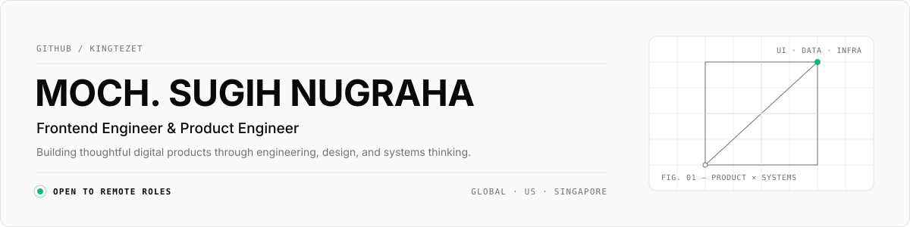
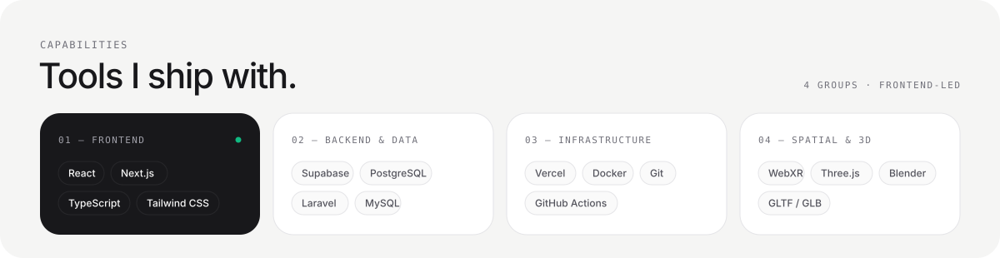
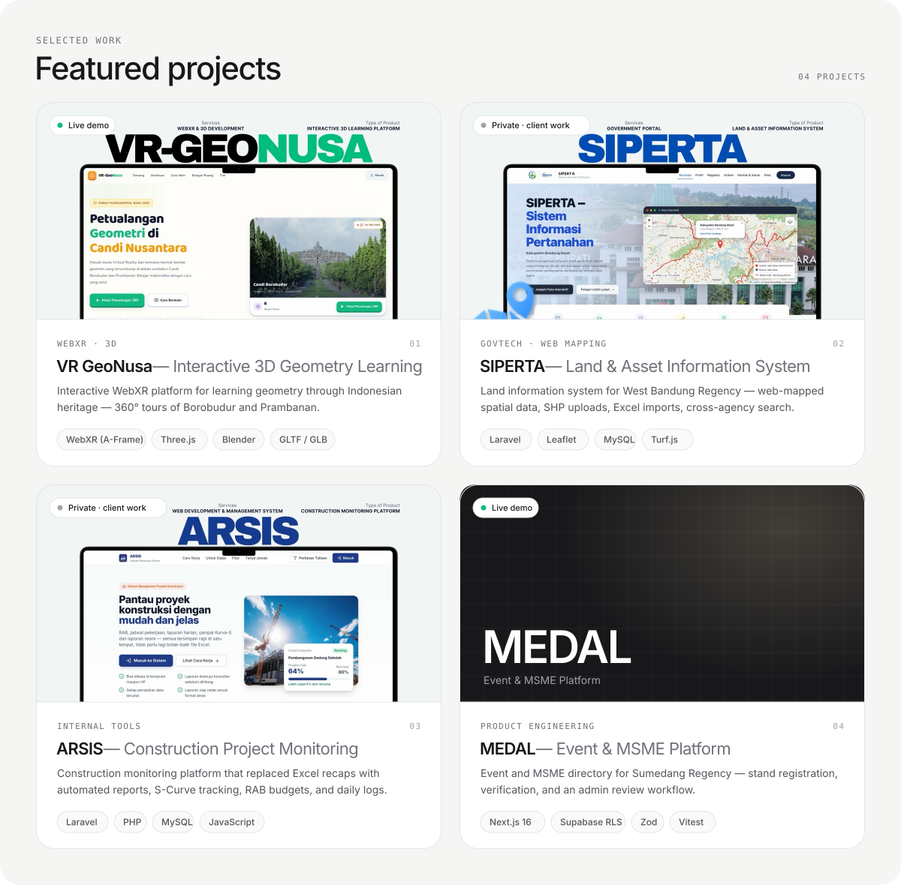
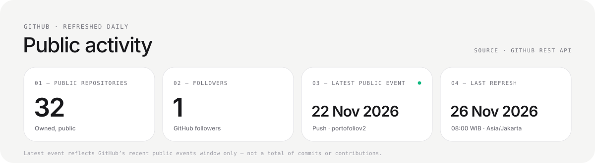

<picture>
  <source media="(prefers-color-scheme: dark)" srcset="assets/svg/hero-dark.svg" />
  <source media="(prefers-color-scheme: light)" srcset="assets/svg/hero-light.svg" />
  
</picture>

 

I'm Moch Sugih Nugraha, a frontend engineer and product engineer focused on React, Next.js, and TypeScript. I build practical web products — from map-based government data tools and construction monitoring platforms to WebXR learning experiences and online ordering apps.

I care about the whole path from interface to data: clean UI, solid database policies, and software people actually use at work.

Currently open to remote opportunities worldwide, including teams in the US and Singapore.

 

<picture>
  <source media="(prefers-color-scheme: dark)" srcset="assets/svg/stack-dark.svg" />
  <source media="(prefers-color-scheme: light)" srcset="assets/svg/stack-light.svg" />
  
</picture>

 

<picture>
  <source media="(prefers-color-scheme: dark)" srcset="assets/svg/projects-dark.svg" />
  <source media="(prefers-color-scheme: light)" srcset="assets/svg/projects-light.svg" />
  
</picture>

| | Project | Links |
|---|---|---|
| 01 | **VR GeoNusa** — interactive 3D geometry learning (research team project) | [Live demo](https://vr-geonusa.my.id) · [Repository](https://github.com/Fathoni89/VR-GeoNusa) |
| 02 | **SIPERTA** — land & asset information system | Private client work |
| 03 | **ARSIS** — construction project monitoring | Private client work |
| 04 | **MEDAL** — event & MSME platform | [Live demo](https://medal-umkm.vercel.app) · [Repository](https://github.com/KingTezet/medal-umkm) |

More work: [Kedai Karuhun](https://github.com/KingTezet/kedai-karuhun) · [NATA OS](https://github.com/KingTezet/nata-website) · [Ruang Tenang](https://github.com/KingTezet/ruang-tenang) · full case studies on the [portfolio](https://mochsugihnugraha.my.id/projects)

 

<picture>
  <source media="(prefers-color-scheme: dark)" srcset="assets/svg/activity-dark.svg" />
  <source media="(prefers-color-scheme: light)" srcset="assets/svg/activity-light.svg" />
  
</picture>

---

**Open to remote roles** — Global · US · Singapore

[Portfolio](https://mochsugihnugraha.my.id) · [LinkedIn](https://www.linkedin.com/in/moch-sugih-nugraha/) · [Email](mailto:mochsugihnugraha@gmail.com) · [GitHub](https://github.com/KingTezet)
